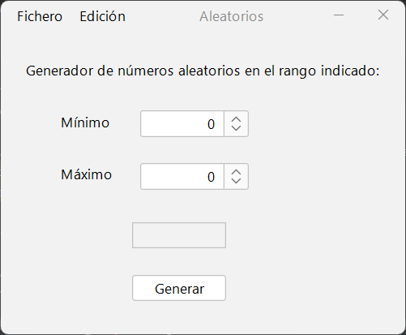

# Práctica 2.4 Generador de números aleatorios y pruebas automatizadas

El objetivo de esta práctica es la de diseñar y desarrollar una aplicación gráfica que permita generar **números aleatorios** dentro de un **rango** definido por el usuario, aplicando los principios de separación básica entre la interfaz y la lógica de la aplicación (Modelo y VistaControlador).

Durante la práctica se trabajará con componentes Swing, FlatLaf, colecciones, diálogos, lectura y escritura de ficheros y empaquetado de aplicaciones Maven.

Además, se introducirán dos niveles diferentes de **pruebas** automatizadas:

- pruebas **unitarias** para comprobar la lógica de la aplicación.
- pruebas de **interfaz gráfica** para comprobar la interacción del usuario con la ventana.

## Preparación del proyecto

Crea dentro de la carpeta `SOL` de tu repositorio local un nuevo proyecto Maven de Apache NetBeans llamado:

`practica2-4`

Utiliza la versión de Java 21 LTS en tu proyecto.

El proyecto deberá utilizar **FlatLaf**, añadiendo la dependencia correspondiente mediante Maven.

Desde el comienzo se organizarán las clases en dos paquetes:

```
Modelo
VistaControlador
```

Utiliza ramas para separar las distintas partes de la práctica:

- `parte-1`
- `parte-2`
- `parte-3`


## Parte 1 Generador de números aleatorios

Crea mediante el editor visual de Apache NetBeans una ventana que permita generar un número aleatorio dentro de un rango indicado por el usuario.

La interfaz deberá contener como mínimo:

- un `JSpinner` para indicar el valor mínimo;
- un `JSpinner` para indicar el valor máximo;
- un `JButton` denominado **Generar**;
- un `JTextField` no editable para mostrar el resultado;
- una barra de menú mediante `JMenuBar`.

La aplicación deberá iniciarse utilizando **FlatLaf**.

### Generación de números aleatorios

Crea dentro del paquete `Modelo` una clase llamada `GeneradorNumeros`

> ⚠️ La generación del número aleatorio **no deberá realizarse directamente dentro del evento del botón**.

Ayúdate de la función `Math.random()` entre dos números o de la clase `radom` así como de una **clase auxiliar** para realizar dichos cálculos.

```java
Math.random() * (max - min + 1) + (min)
```

```java
Random rnd = new Random();
rnd.nextDouble() * max + min
```

Antes de realizar la generación deberá verificarse si el rango indicado es correcto, o deberá mostrarse un mensaje mediante `JOptionPane`.

### Menú de la aplicación

Añade los siguientes menús:

```text
Fichero
Edición
```

Dentro del menú **Fichero**:
- La opción **salir** que deberá cerrar la aplicación.

Dentro del menú **edición**:
- La opción **Reiniciar** deberá restablecer los valores de los `JSpinner` y devolver los campos de la aplicación a su estado inicial.




## Parte 2 Números primos, historial y ficheros. Empaquetado

Amplía ahora la aplicación con nuevas funcionalidades.

### Generación de números primos 

Agrega un *checkbox* que en caso de estar marcado solo permita mostrar números **primos** entre los rangos indicados.

La comprobación de si un número es primo deberá realizarse completamente dentro del paquete `Modelo`.

### Historial de números generados

Agrega en el *menú edición* las siguientes opciones: 
- Una opción llamada **historial** que permita ver los últimos números generados.
- Otra opción llamada **borrar todo** para eliminar el listado guardado del historial.

Antes de borrar el contenido del historial la operación deberá solicitar confirmación mediante un `JOptionPane`.

Para ello deberás utilizar en una ventana modal (`JDialog`). Esta ventana contedrá una lista (`JList`). Puedes editar la disposición de dicha ventana de diálogo desde el editor de Netbeans en la pestaña del *Navigator* en *Other Components*. 

Puedes utilizar una colección como ``ArrayList<Integer>`` para almacenarlos.

El historial deberá pertenecer a la **lógica** de la aplicación y no únicamente en los componentes gráficos, es decir, el historial no debería almacenarse únicamente en el JFrame.


### Guardar historial en un fichero

Agrega en el *menú fichero* la opción **guardar historial**.

Para guardar dicho historial del listado se ha de utilizar un `JFileChooser` para permitir al usuario seleccionar la ubicación y el nombre del fichero. 

El historial deberá guardarse en un fichero de texto.

Por ejemplo:

```text
Historial de números generados:
23
17
41
8
```

Se deberá verificar si ya existe un fichero con el mismo nombre antes de sobreescribirlo.  

> No olvides gestionar los errores mediante try-catch dentro del código de la aplicación.


### Empaquetado y ejecución

Una vez terminada la aplicación vamos a generar el fichero distribuible del proyecto.

En un proyecto Maven, el resultado del empaquetado será normalmente un fichero `jar` que se generará dentro de la carpeta `target`.

Desde Netbeans:

- Haz clic derecho sobre el proyecto.
- Selecciona *Clean and Build*.
- Comprueba en la ventana Output que aparece: BUILD SUCCESS

Ahora comprueba que puedes ejecutarlo desde consola con:

```
java -jar nombre-del-fichero.jar
```

También puedes empaquetar el proyecto desde una terminal situada en la carpeta donde está el *pom.xml* usando el comando mvn, si has instalado previamente **Maven** en tu sistema operativo:

```
mvn clean package
```

## Parte 3 Pruebas (testing)

En este apartado vamos a tratar con pruebas unitarias y pruebas automatizadas sobre la interfaz.

### Pruebas unitarias de la lógica

En esta parte se crearán **pruebas automatizadas sobre las clases del paquete `Modelo`**, sin necesidad de abrir ninguna ventana.

Añade al proyecto la dependencia de **JUnit 4** con ámbito de test en el fichero `pom.xml`

Crea dentro de `Test Packages` una clase llamada `GeneradorNumerosTest` 

**Prueba del método esPrimo()**

Implementa pruebas que comprueben al menos los siguientes casos:

```text
2   → primo
7   → primo
4   → no primo
15  → no primo
1   → no primo
0   → no primo
```

Por ejemplo:

```java
@Test
void numeroSieteDebeSerPrimo() {
    GeneradorNumeros generador = new GeneradorNumeros();

    assertTrue(generador.esPrimo(7));
}
```

**Prueba de generación dentro del rango**

Crea una prueba que genere números repetidamente y compruebe que todos ellos están dentro del rango indicado.

Por ejemplo:

```text
mínimo = 5
máximo = 10
```

Todos los resultados deberán cumplir:

```text
5 <= resultado <= 10
```

Realiza la comprobación varias veces dentro de la misma prueba.


### Prueba automatizada de la interfaz

Finalmente, realiza una prueba automatizada de la interfaz utilizando la librería **AssertJ Swing**.

El objetivo es comprobar de forma programática que el generador de números aleatorios funciona correctamente cuando el usuario introduce valores en los campos JSpinner y pulsa el botón “Generar”.

1. Asegúrate de incluir las dependencias de *AssertJ Swing* y *JUnit 4* en tu proyecto editando el fichero `pom.xml`.

2. Asegúrate de que los elementos que vayas a testear tengan identificadores (names) asignados a los componentes que vayas a testear para que AssertJ Swing los localice:

```java
spinnerMin.setName("spinnerMin");
spinnerMax.setName("spinnerMax");
botonGenerar.setName("botonGenerar");
campoResultado.setName("campoResultado");
```

> Estos identificadores son independientes del nombre de la variable Java, aunque resulta recomendable que ambos sean similares.

3. Debes crear en el paquete de VistaControaldor una nueva **clase de prueba** en *Test Packages>new Java Class* que se llame como la clase principal del *JFrame()* acabada en Test.

4. Código de prueba propuesto (orientativo):

```java
import static org.assertj.core.api.Assertions.assertThat;

import org.assertj.swing.annotation.GUITest;
import org.assertj.swing.edt.FailOnThreadViolationRepaintManager;
import org.assertj.swing.fixture.FrameFixture;
import org.junit.jupiter.api.*;

public class GeneradorNumerosTest {

    private FrameFixture ventana;

   @Before
    public void setUp() {
        // Comprobar que las acciones Swing se hacen en el hilo correcto
        FailOnThreadViolationRepaintManager.install();

        // Inicializar la ventana de prueba en el EDT
        GeneraNumeros frame = GuiActionRunner.execute(() -> new GeneraNumeros()); // <-- Creación segura de la instancia
        
        // Inicializar el FrameFixture
        ventana = new FrameFixture(frame); 
        
        // Mostrar la ventana en el EDT
        ventana.show(); 
    }

    @After
    void tearDown() {
        // Cierra la ventana después de cada prueba
        ventana.cleanUp();
    }

    @Test
    public void deberiaGenerarNumeroAleatorioEntreValoresSpinner() {
        // Introduce los valores en los spinners
        ventana.spinner("spinnerMin").enterText("5");
        ventana.spinner("spinnerMax").enterText("10");

        // Pulsa el botón "Generar"
        ventana.button("botonGenerar").click();

        // Obtiene el resultado mostrado en el JTextField
        String textoResultado = ventana.textBox("campoResultado").text();

        // Convierte el resultado a número y comprueba el rango
        int valor = Integer.parseInt(textoResultado);
        assertThat(valor)
            .as("El número generado debe estar entre 5 y 10")
            .isBetween(5, 10);
    }
}
```

5. Para ejecutar la prueba haz clic sobre la clase y en el menú contextual en *Test File*

6. Agrega dicho caso automatizado a la tabla de pruebas anterior.


## Documentación y entrega

### Documentación

Crea una carpeta `docs` en el repositorio y dentro un archivo `index.md`.

Que incluya como mínimo:

- Nombre del proyecto
- Descripción: Breve explicación de la aplicación desarrollada.
- Listado de Funcionalidades: Lista de las principales características implementadas.
- Capturas de la aplicación.
- Tipos de pruebas realizadas.
- Explica cómo y dónde ejecutar la aplicación.

Explica brevemente la función de los paquetes:

- Modelo
- VistaControlador


### Entrega

Antes de entregar la práctica comprueba:

- [ ] El proyecto utiliza Maven.
- [ ] FlatLaf está configurado correctamente.
- [ ] El código está organizado en `Modelo` y `VistaControlador`.
- [ ] La generación de números se realiza fuera del `JFrame`.
- [ ] El rango mínimo y máximo se valida correctamente.
- [ ] La aplicación puede generar únicamente números primos.
- [ ] Se contempla un rango sin números primos.
- [ ] El historial almacena todos los resultados generados.
- [ ] El historial puede visualizarse mediante un `JDialog`.
- [ ] El historial puede borrarse.
- [ ] El historial puede guardarse mediante `JFileChooser`.
- [ ] Se solicita confirmación antes de sobrescribir un fichero.
- [ ] Los posibles errores de escritura se gestionan correctamente.
- [ ] Existen pruebas unitarias para la lógica del modelo.
- [ ] Existe al menos una prueba automatizada de interfaz con AssertJ Swing.
- [ ] Los componentes utilizados por AssertJ Swing tienen asignado un `name`.
- [ ] Maven genera correctamente el fichero `.jar`.
- [ ] El `.jar` puede ejecutarse desde consola.
- [ ] El `README.md` está actualizado.
- [ ] Las pruebas manuales están documentadas.
- [ ] Las ramas de trabajo se han integrado correctamente en `main`.
